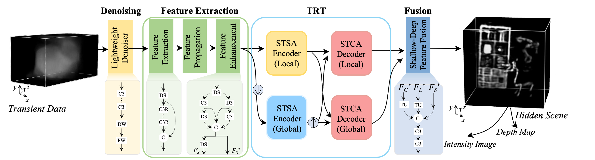

# TRT-NLOS

TRT-NLOS extends [NLOST (CVPR 2023)](https://github.com/Depth2World/NLOST)
with a light denoising network before transient normalization and reconstruction.

## Architecture



```text
Transient [B, 1, 512, H, W]
  -> LightDenoisingNet
  -> min-max normalization
  -> transient feature expansion / downsampling
  -> differentiable FK migration
  -> local / global spatio-temporal self-attention encoders
  -> spatio-temporal cross attention decoders
  -> volume reconstruction
  -> intensity and depth rendering
```
Download `trt_nlos.pth` from
[the shared model folder](https://pan.quark.cn/s/23463e95c2b3). Original NLOST weights do not contain the denoiser
and are not interchangeable with TRT-NLOS weights.


## Acknowledgements

This code builds on [NLOST](https://github.com/Depth2World/NLOST). Dataset links and the prior-work citation are available
in that repository.
